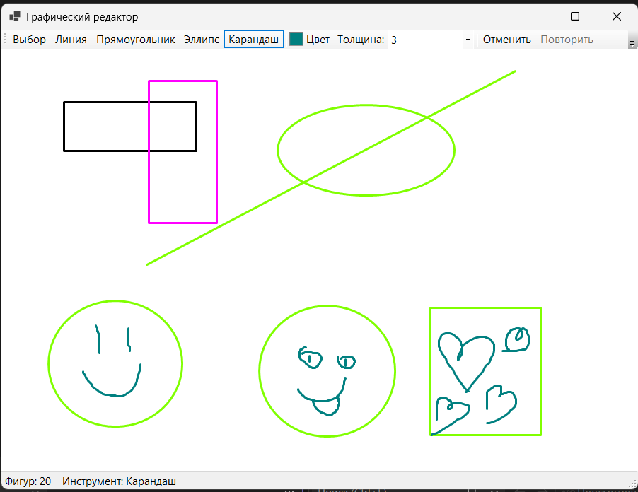

# Лаба 2. Графический редактор

Автор: Тоскин Эдгард, группа Б9125-01.03.02ии4

Графический редактор на C# (WinForms, .NET 8): линии, прямоугольники, эллипсы и рисование карандашом.



## Как запустить

Нужны Windows и .NET SDK 8 или новее.

```
cd lab2-paint
dotnet run
```

Или откройте `PaintApp.csproj` в Visual Studio и нажмите «Запуск».

## Как пользоваться

- Выберите инструмент сверху, цвет и толщину, потом рисуйте мышью. Пока кнопка зажата, виден предпросмотр.
- Инструмент «Выбор»: щёлкните по фигуре, чтобы выделить, тяните мышью, чтобы переместить, Delete удаляет.
- Ctrl+Z отменяет, Ctrl+Y повторяет. «Очистить» убирает все фигуры.
- «Сохранить» и «Открыть» работают с файлом `.json`, «В PNG» сохраняет картинку.

## Чек-лист

- [x] Окно: холст, инструменты, цвет, толщина, подсветка выбранного инструмента
- [x] Фигуры: линия, прямоугольник, эллипс с предпросмотром, карандаш
- [x] Иерархия: абстрактный `Shape`, свой `Draw` у каждой фигуры, один цикл рисования
- [x] Отмена (Ctrl+Z) и очистка, методы `Drawing`
- [x] Сохранение в JSON и открытие, фигуры создаёт фабрика
- [x] README
- [x] ★ Выделение щелчком, перемещение мышью, удаление клавишей Delete (`Shape.Contains`)
- [x] ★★ Отмена и повтор через паттерн «Команда», экспорт в PNG

## Как устроен проект

Кто от кого наследуется:

```
Shape (абстрактный)
 ├── LineShape
 ├── RectShape
 ├── EllipseShape
 └── PencilShape  (хранит список точек)
```

- `Shape` общее для фигур: точки, цвет, толщина. `Draw` и `Contains` абстрактные, каждая фигура реализует их сама.
- `Drawing` содержит список фигур (композиция): добавить, удалить, нарисовать все, найти фигуру под точкой, сохранить и загрузить.
- `ShapeFactory` создаёт фигуру по имени типа. Её используют мышь и загрузка из файла.
- `ICommand`, `AddShapeCommand`, `RemoveShapeCommand`, `ClearCommand`, `CommandHistory` отмена и повтор.
- `MainForm` окно, `CanvasPanel` холст без мерцания.

Использованы `System.Text.Json` и `System.Drawing`.

## Как добавить треугольник

1. Написать класс `TriangleShape : Shape` со своими `TypeName`, `Draw` и `Contains`.
2. Добавить строку `["triangle"] = ...` в словарь `ShapeFactory`.
3. Добавить пару `("triangle", "Треугольник")` в массив `Tools` в `MainForm`.

Цикл рисования и загрузка из файла менять не нужно.
