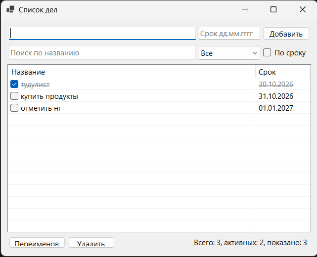

# Лаба 1. Список дел

Автор: Тоскин Эдгард, группа Б915-01.03.02ии

Приложение «Список дел» на C# (WinForms, .NET 8).



## Как запустить

Нужны Windows и .NET SDK 8 или новее.

```
cd lab1-todo
dotnet run
```

Задачи сохраняются в `%LocalAppData%\TodoApp\todos.json`.

## Чек-лист

- [x] Модель: `TodoItem` и `TodoList`, поля закрыты
- [x] Окно: поле ввода, кнопка «Добавить», список с галочкой и сроком
- [x] Операции: выполнить, переименовать, удалить
- [x] Ошибки: пустое название, не выбрана задача, неверный срок
- [x] Сохранение в JSON и загрузка при запуске
- [x] README
- [x] ★ Фильтр (все / активные / выполненные) и сортировка по сроку
- [x] ★★ Поиск по мере ввода, просроченные задачи выделены цветом

## Как устроен проект

- `TodoItem` одна задача (название, выполнена ли, срок).
- `TodoList` список задач: добавление, удаление, фильтр, поиск, сортировка, сохранение и загрузка.
- `MainForm` окно, вызывает методы `TodoList` и показывает ошибки.
- `PromptDialog` маленькое окно для переименования.

Наследования нет. Использованы `System.Text.Json` и LINQ.
