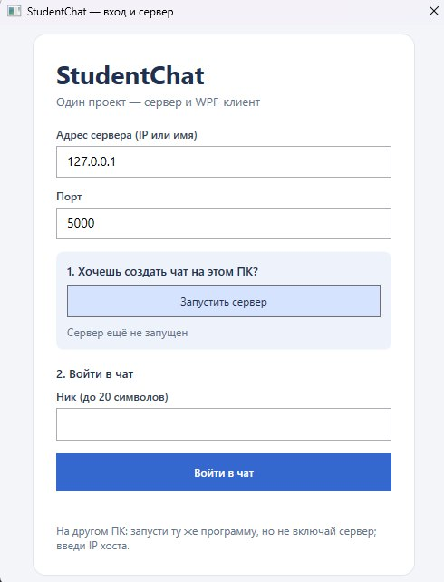
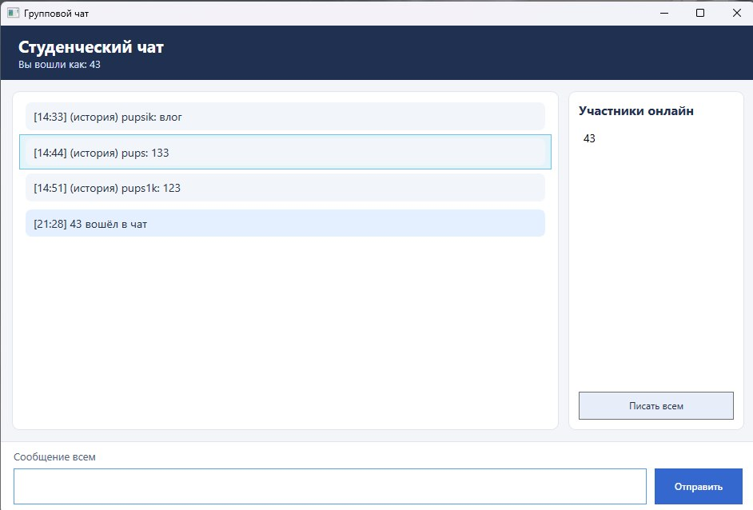

## 1\) Запуск

Открыть StudentChat.sln в Visual Studio Community.

Собрать проект и запустить через Ctrl + F5.

На первом компьютере нажать «Запустить сервер».

Ввести IP-адрес сервера, порт 5000 и ник.

На других компьютерах запустить приложение и подключиться к серверу по его IP.

## 2\) Скриншот

В папке 

## 3\) Чек-лист

1\. Сервер и клиент. Отдельные программы. Адрес и порт вводятся в окне входа. Работает на разных компьютерах.

2\. Вход. Вход с ником, отказ при занятом нике, уведомления о входе и выходе.

3\. Чат. Лента с ником и временем, отправка кнопкой и Enter, сообщение получают все. Список онлайн актуален.

4\. Классы и протокол. Классы из таблицы (или аналогичные). Сетевой клиент не зависит от окна. Протокол описан в README.

5\. Устойчивость. Окно не замирает. Отключение клиента не ломает сервер и остальных. Недоступный сервер: сообщение, а не вылет.

6\. README. Как запустить, скриншот, чек-лист, как устроен проект, протокол, кто что делал.

Доп. задания

★ (3 балла). Личные сообщения: выбрать адресата в списке онлайн, сообщение видят только двое, в ленте оно выделено.

★★ (3 балла). История: сервер сохраняет сообщения в файл и отправляет новому клиенту последние 20, в том числе после перезапуска сервера.

## 4\) Структура проекта

Models — классы ChatMessage и ChatLine, хранение данных сообщений

Networking — ChatServer, ClientHandler, ChatClient, сетевое взаимодействие

Views — окна входа и чата, интерфейс WPF

## 5\) Протокол

Сообщения передаются через TCP в формате JSON, по одному сообщению в строке

## 6\) Кто что делал

Эдгард Тоскин: разработка сервера, обработка подключений, рассылка сообщений, сохранение истории

Антон Узюмов: разработка WPF-интерфейса, сетевого клиента, отображение сообщений и участников

